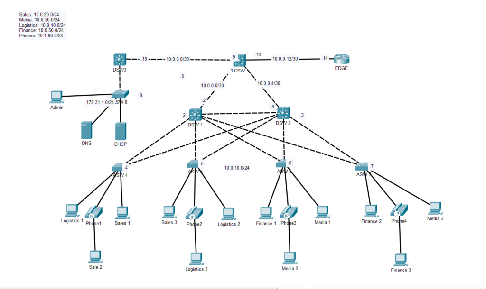
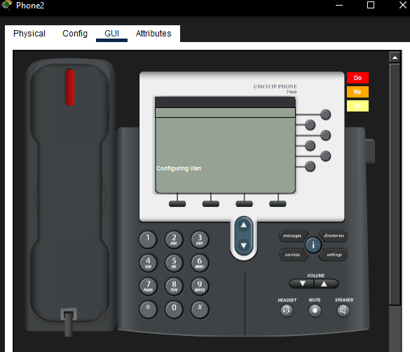
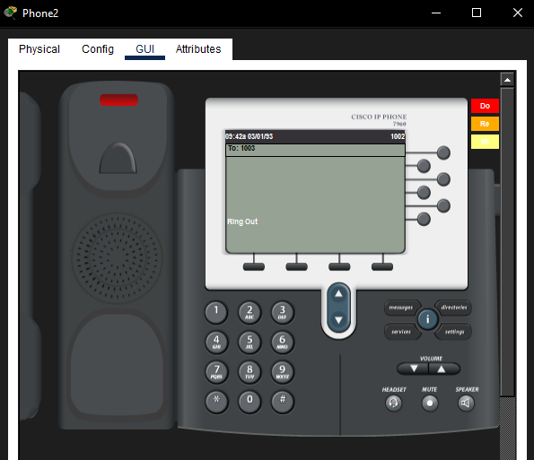

# Cisco IP Phone Troubleshooting – CDP and Voice VLAN Discovery

## Project Overview

This lab focused on troubleshooting a Cisco IP telephony issue in which **Phone1 and Phone2 powered on but could not place calls**. Their extension numbers were also missing from the phone displays.

Phone3 and Phone4 were functioning normally, providing working devices for comparison. After investigating the access-switch configurations, the issue was traced to **CDP being disabled on the phone-facing interfaces** of the switches serving Phone1 and Phone2.

Enabling CDP on those interfaces allowed the affected phones to discover the voice VLAN information advertised by the switches. The phones then displayed their assigned extension numbers and successfully placed calls.

## Problem Statement

Users reported that Phone1 and Phone2 were unable to place calls.

Initial observations:

- All four IP phones powered on.
- Phone1 and Phone2 did not display their extension numbers.
- Phone3 and Phone4 displayed their extension numbers and could place calls.
- Initial connectivity and routing checks did not reveal a problem.
- CME and phone configurations were specified as correct in the lab instructions.

**Completion criteria:** Phone1 and Phone2 had to display their assigned numbers and successfully place calls, matching the working phones.

## Topology

The lab contained four Cisco IP phones connected to access switches, with the access switches connected to the distribution layer and CME services elsewhere in the network.



## Troubleshooting Process

### 1. Initial checks

Connectivity and routing were tested first. These checks did not identify the cause of the issue.

Because Phone3 and Phone4 were working, their switch configurations were used as a reference when investigating the affected phones.

### 2. Compare working and failing access switches

The following checks were performed on the access switches:

```cisco
show cdp neighbors
show vlan brief
show running-config
```

The phone-facing interface was also inspected on the relevant switches.

A key difference was identified:

- The working access switches advertised their connected IP phones through CDP.
- ASW4 did not list Phone1 as a CDP neighbor.
- Further inspection showed that CDP was disabled on ASW4 interface FastEthernet0/5, which connected to Phone1.

The same issue was found on the phone-facing interface of the switch serving Phone2.

### 3. Identify the root cause

CDP was disabled on the interfaces connected to Phone1 and Phone2.

Cisco IP phones can use CDP advertisements from the switch to learn voice VLAN information. With CDP disabled on the affected interfaces, the phones were not receiving the required voice-network information through that mechanism.

## Root Cause

**CDP was disabled on the phone-facing FastEthernet0/5 interfaces on the access switches connected to Phone1 and Phone2.**

This prevented the phones from learning the voice VLAN information advertised by their access switches.

## Solution

CDP was enabled on the affected phone-facing interfaces.

On each affected access switch:

```cisco
enable
configure terminal
interface fastEthernet0/5
cdp enable
end
```

The change was applied to the interfaces connected to Phone1 and Phone2. No routing or CME configuration changes were required.

## Verification

After enabling CDP:

1. The affected phones appeared in the access switches' CDP neighbor tables.
2. Phone1 and Phone2 displayed their assigned extension numbers.
3. The phone displays matched the expected completed-lab state.
4. Test calls between phones completed successfully.

Useful verification commands:

```cisco
show cdp neighbors
show cdp interface fastEthernet0/5
show running-config interface fastEthernet0/5
```

## Screenshots

### Before the fix

The initial screenshot records the affected phone state before the correction.



### Network topology


### Lab completed

The final screenshot shows the phones displaying their extension numbers after the correction.



## Key Takeaways

- A phone powering on does not necessarily mean it has successfully joined the voice network.
- CDP is useful in Cisco IP telephony because phones can use switch advertisements to discover voice VLAN information.
- Comparing working and failing devices is an effective way to identify configuration differences.
- `show cdp neighbors` and `show cdp interface` are useful commands when investigating phone discovery problems.
- Always verify the result from both the network-device side and the end-device side. In this lab, successful test calls provided end-to-end confirmation.

## Lab Status

**Completed** — Phone1 and Phone2 displayed their assigned extension numbers and successfully placed calls.
